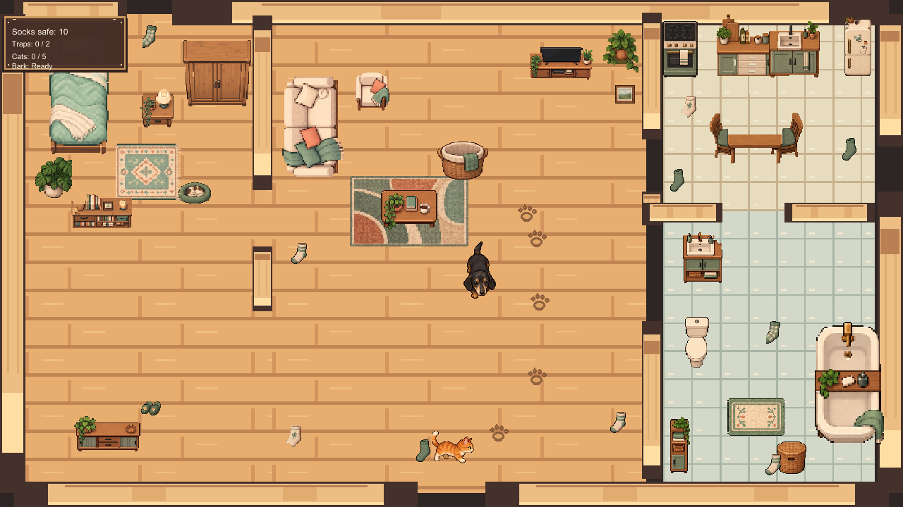
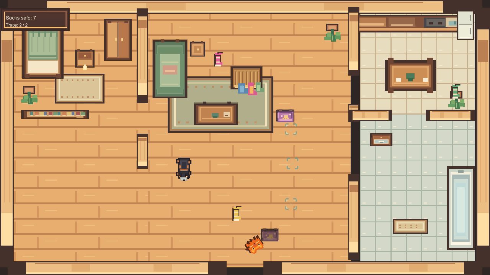
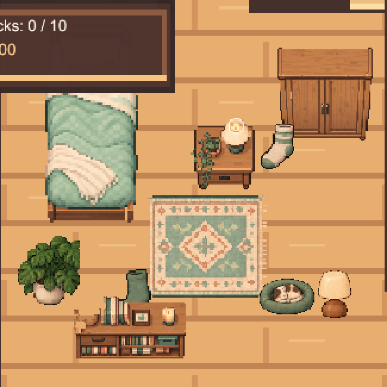

# BulkoGame

A 2D top-down game where Bulka protects collected socks from cats across ten campaign levels.

Collect socks → deposit them → defend them from cats.

## Download

- [Windows x86_64](https://github.com/Alexandra-St/BulkoGame/releases/download/v0.6.0-alpha/BulkoGame_Alpha_0.6_Windows.zip)
- [macOS Universal (Apple Silicon + Intel)](https://github.com/Alexandra-St/BulkoGame/releases/download/v0.6.0-alpha/BulkoGame_Alpha_0.6_macOS.zip)

[Full Alpha 0.6 Release](https://github.com/Alexandra-St/BulkoGame/releases/tag/v0.6.0-alpha)

The macOS build is unsigned. If macOS blocks the first launch, use System Settings → Privacy & Security → Open Anyway.

## Defense

After the collect phase, defend deposited socks from cats following authored routes. Bulka can place traps and bark to stop them.

## Apartment

## Controls

- WASD / Arrow Keys — Move
- E — Place trap
- Space — Bark
- Escape — Pause

## Project

Built with Unity 6000.5.5f1. `LevelDefinition` stores level configuration, `LevelSceneBindings` connects authored scene objects, `LevelBootstrap` assembles runtime systems, and `GameSessionState` tracks a run. Editor tools support level authoring and validation.

Windows x86_64 builds use the Unity Editor build pipeline and go under `Builds/Windows/`.

Audio files are intentionally omitted from this public repository.
They are third-party generated assets subject to separate licensing terms;
this does not affect review of the project's code and architecture.

## License

This repository is provided for portfolio and code review purposes only.
No license is granted to use, copy, modify, redistribute, or create derivative
works from the source code or project assets unless explicitly permitted by the author.
